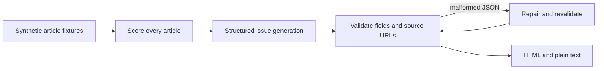

# Newsletter pipeline demo

A Python example of taking source articles through relevance scoring, structured newsletter generation, source-URL validation, JSON repair, and HTML/plain-text rendering. Adapted from Clarity Works tooling by Vatsal Jain with AI-assisted development.

The default demo uses invented articles and in-memory HTTP responses. It exercises the implementation's validation and repair paths without credentials, network requests, or email delivery. This is a technical showcase; its fixture output is not a live news issue or a quality benchmark.

## Run it

Python 3.11+:

```sh
python3 -m venv .venv
source .venv/bin/activate
python -m pip install -r requirements.lock
python offline_demo.py
python -m unittest discover -s tests -v
```

Open `output/newsletter.html`, or inspect the saved [synthetic example](examples/newsletter.html). To exercise malformed model JSON and its repair path:

```sh
python offline_demo.py --malformed --output output/repair-example
```

## Flow



`offline_demo.py` injects `httpx.MockTransport` clients into the real Python scoring and generation functions. Model responses are fixtures; schema checks, source membership checks, retries/repair orchestration, escaping, and rendering are implementation code. `sources.py` contains optional live source adapters; the offline demo does not invoke them.

## Decisions and boundaries

- **Validate model output against the input.** A source URL must belong to the supplied article set. This checks provenance boundaries; it does not establish the truth of the article or generated interpretation.
- **Recover bounded failures.** Malformed JSON can be repaired and revalidated. Invalid scoring output can fall back to heuristic scoring. A fallback should be visible in incident records rather than represented as successful model scoring.
- **Separate demonstration from operation.** Production email sending, n8n credential provisioning and workflow activation are excluded. No sending command exists in this repo.
- **Keep two implementations distinct.** This sample covers the Python path. Tests here do not certify a separate deployed n8n workflow.

The fixture news items are invented. Tests cover output contracts and failure behavior, rather than real-world factual accuracy, subscriber engagement, uptime or production throughput. No operating or business-result claim is derived from the demo.

## Optional live-provider development

Live scoring/generation can be called from Python with your own OpenRouter key. Live sourcing additionally uses public feeds and optionally Tavily. These calls may incur provider charges. Configuration is read from environment variables; `.env` loading is explicitly enabled with `NEWSLETTER_LOAD_DOTENV=1`. The quickstart and CI use fixtures only.

Keep credentials and generated operational logs outside Git. `.env.example` contains empty placeholders. Do not use this showcase as a production sender.

## Files and contribution

- `sources.py`: source freshness, normalization and deduplication.
- `scoring.py`: score validation, retry feedback and heuristic fallback.
- `generator.py`: structured issue parsing/repair, URL checks and rendering.
- `offline_demo.py` and `examples/`: synthetic inputs, fixture provider and sample output.
- `tests/`: existing implementation tests plus showcase boundary checks.

See [PROVENANCE.md](PROVENANCE.md) for the extraction boundary and additions. Vatsal's broader work is described at [vatsaljain.com](https://vatsaljain.com). No open-source license has been assigned to this showcase.
